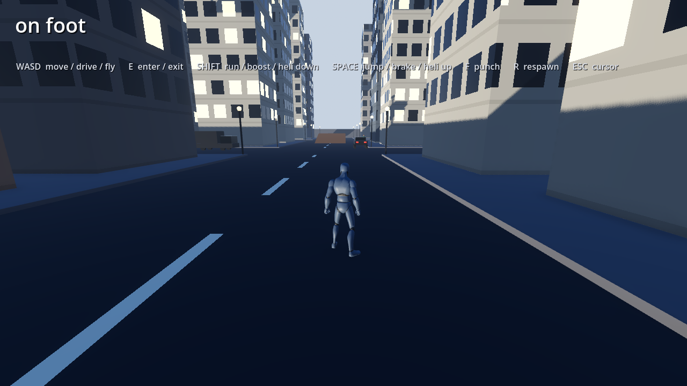
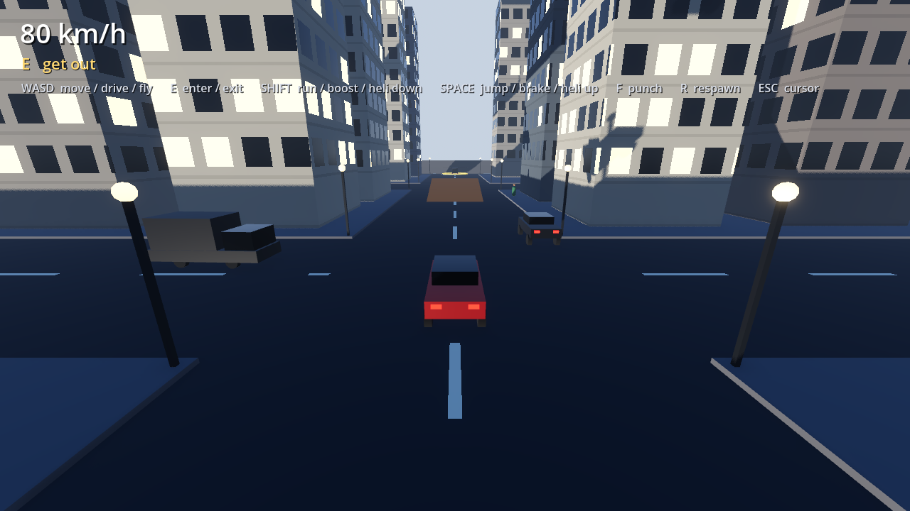
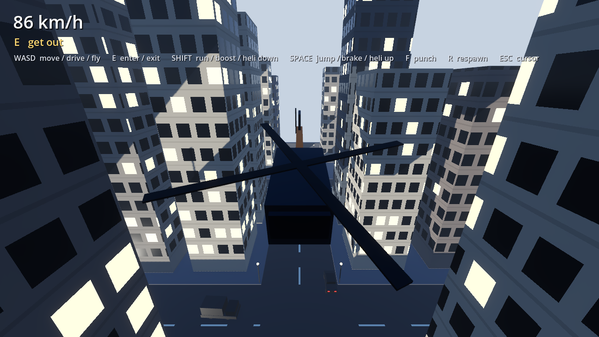

# OpenCity

An open-world driving prototype built on **Godot 4.7**: everything open source,
nothing depending on another game's assets. Walk, drive cars and a truck, fly a
helicopter and hit stunt ramps in a procedurally built city with ambient
traffic and pedestrians.

Open source (MIT), part of [github.com/webgl-games](https://github.com/webgl-games).

| On foot | Driving | Flying |
|---|---|---|
|  |  |  |

## Run it

Install [Godot 4.7](https://godotengine.org/download) (the standard build; no
C#/.NET needed), then either open the Godot editor and import this folder, or
run it from a terminal:

```
godot --path .
```

On macOS the binary lives inside the app bundle:
`/Applications/Godot.app/Contents/MacOS/Godot --path .`

The first launch imports the assets into `.godot/` (ignored by git), which
takes a few seconds.

**Controls**

| Key | On foot | In car / truck | In helicopter |
|---|---|---|---|
| `WASD` | Move | Drive | Fly / turn |
| `SHIFT` | Run | Boost | Descend |
| `SPACE` | Jump | Brake | Climb |
| `E` | Enter nearby vehicle | Get out | Get out |
| `F` | Punch | — | — |
| `MOUSE` | Look | Look | Look |
| `R` | — | Respawn | — |
| `ESC` | Release the mouse cursor | | |
| `F12` | Screenshot to `screenshots/` | | |

The helicopter sits on the glowing helipad at the far north end of the spawn
road. Stunt ramps: two on the east-edge strip (traffic-free drag strip), one on
the spawn road heading north.

## What's here

| File | What it does |
|---|---|
| `scenes/world.tscn` | Main scene: sky, sun, city, player, car, camera, HUD, traffic, pedestrians |
| `scenes/car.tscn`, `scenes/truck.tscn` | `VehicleBody3D` vehicles with four wheels and greybox bodies |
| `scenes/player.tscn` | On-foot player using the Quaternius mannequin (see `CREDITS.md`) |
| `scripts/game.gd` | Owns the on-foot / in-vehicle state, entering and leaving vehicles |
| `scripts/player.gd` | Third-person on-foot controller: walk, run, jump, punch |
| `scripts/car.gd` | Arcade driving: throttle, brake, boost, speed-tapered steering |
| `scripts/heli.gd` | Arcade helicopter |
| `scripts/city.gd` | Procedurally builds the city (roads, sidewalks, towers) |
| `scripts/traffic.gd`, `scripts/traffic_car.gd` | Ambient traffic that keeps to its lane and turns at intersections |
| `scripts/peds.gd`, `scripts/ped.gd` | Pedestrians walking sidewalk loops, diving clear of cars |
| `scripts/parked_cars.gd` | Enterable parked cars, the truck and the helicopter |
| `scripts/props.gd` | Street furniture (lamp posts) and the stunt ramps |
| `scripts/follow_camera.gd` | Mouse-orbit third-person camera that follows whatever you control |
| `scripts/chase_camera.gd` | Earlier chase camera, kept for reference (not used by the main scene) |
| `scripts/hud.gd` | Speed readout and enter/exit prompt |
| `scripts/dev_capture.gd` | F12 screenshots, plus the automated test modes below |
| `scripts/tools/` | Small headless tools that print the character GLB's animations and materials |
| `shaders/` | Building facades and road markings, drawn in shaders instead of textures |

## Verifying changes without watching

```
# boot the game, screenshot one frame, quit
godot --path . -- --shot

# run on foot for 5s, logging speed and position
godot --path . -- --walk

# get in the car, hold throttle 5s, log, screenshot, quit
godot --path . -- --drive

# same but holding SHIFT
godot --path . -- --boost

# get in the helicopter, fly forward and climb
godot --path . -- --fly
```

These synthesise real key events rather than poking `engine_force` directly, so
they exercise the same input path a player would: `--drive` even gets into the
car through the normal `E` code path. Watch the printed coordinates: on a
straight input the cross-axis should stay *pinned*. Drift there has caught two
real bugs already. Each test saves its screenshot into `screenshots/`.

## Things worth knowing

- **A positive `engine_force` pushes this chassis toward local +Z**, but the car
  model faces −Z. `car.gd` negates the throttle to compensate (`FORWARD`).
  This was measured, not assumed: if you rebuild the car scene, re-check it
  with `--drive` and confirm the Z coordinate goes *negative*.
- The city uses a **fixed RNG seed** (`city.gd`) so the layout is identical every
  run while handling is being tuned. Change or remove the seed for variety.
- Apart from the CC0 player mannequin, everything visible is placeholder
  geometry. It exists so the driving feel and camera can be tuned before anyone
  spends time on art.

## Next steps

- Mission / objective system
- Day/night cycle (the lamp posts are already emissive)
- Real art: Blender models, or CC0 asset packs (Kenney, Poly Haven)
- Sound: engines, footsteps, city ambience

## Licence

Code is MIT, see [`LICENSE`](LICENSE). Third-party assets and their licences
are listed in [`CREDITS.md`](CREDITS.md).
